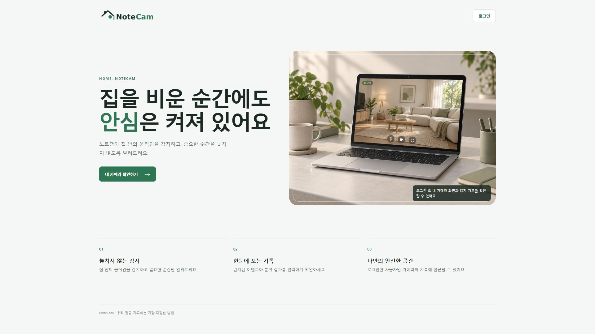
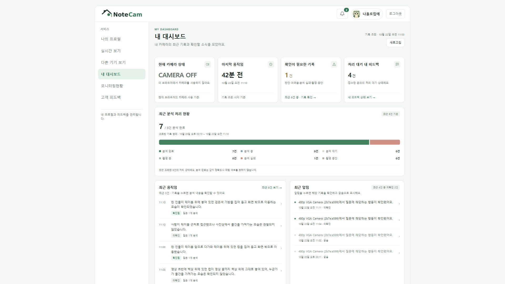
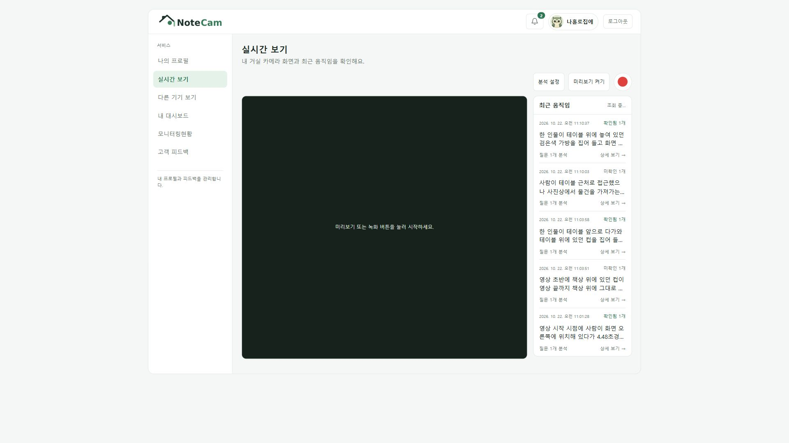
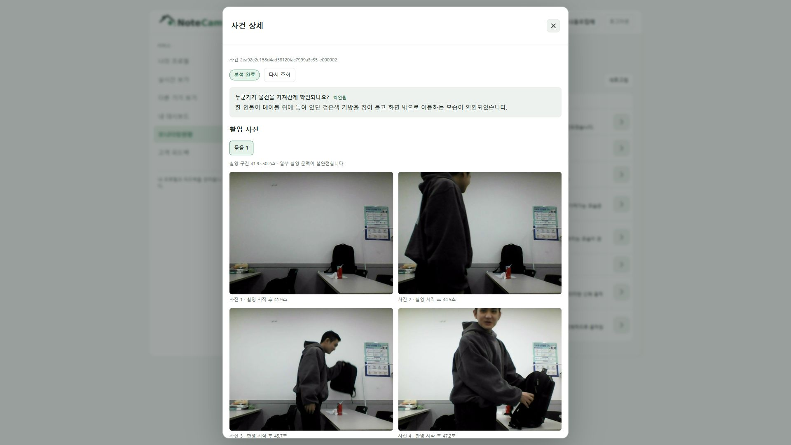
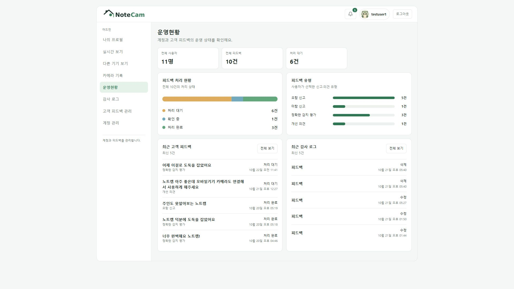
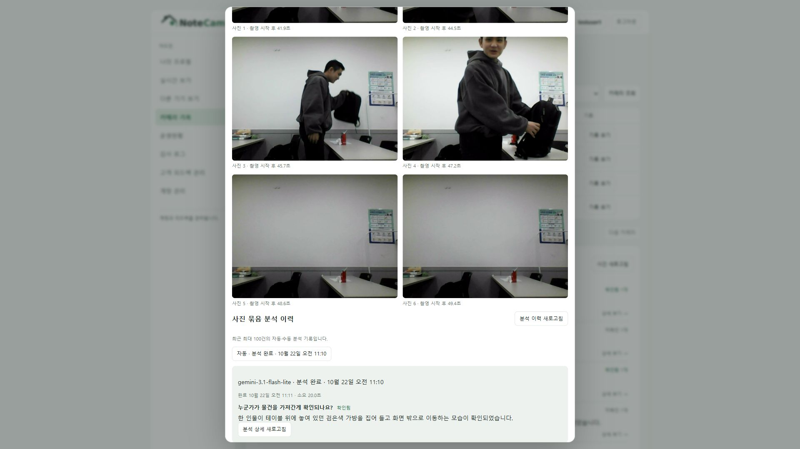
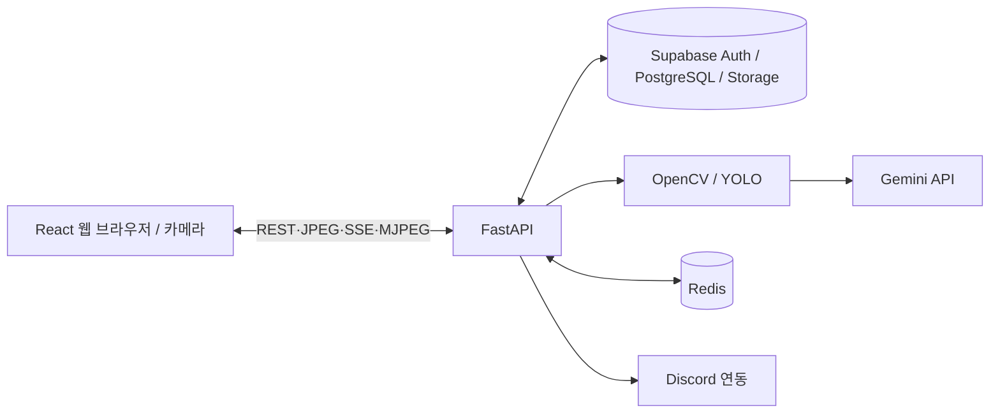

# NoteCam | AI 홈 CCTV

> 별도의 CCTV 장비 없이 브라우저 웹캠으로 움직임을 감지하고, Gemini AI로 사건을 분석해 기록·알림을 제공하는 홈 모니터링 서비스

**엔코아 AI 캠퍼스 · AIO 03기 · P1 Team 2**

[시스템 구성도](docs/architecture.md) · [API 명세서](docs/api-design.md) · [DB 설계서 / 논리·물리 ERD](docs/database-design.md) · [화면 설계서](docs/screen-design.md)

## 프로젝트 소개

NoteCam은 집 안의 상황을 확인하고 싶지만 별도 홈캠 구매가 부담스러운 사용자를 위한 AI 홈 모니터링 서비스입니다. 브라우저에서 촬영한 프레임을 FastAPI로 전송하고, 움직임 감지·사진 저장·AI 분석 결과 조회를 연결합니다.

## 서비스 화면

| 메인 화면 | 사용자 대시보드 |
|---|---|
|  |  |
| 실시간 보기 | AI 사건 상세 |
|  |  |
| 관리자 운영현황 | 관리자 Gemini 분석 기록 |
|  |  |

[전체 18개 화면 및 기능 명세 보기](docs/screen-design.md)

## 주요 기능

| 구분 | 기능 |
|---|---|
| 계정 | Supabase Auth 기반 회원가입·로그인, 프로필, 사용자/관리자 역할 분리 |
| 카메라 | 브라우저 카메라 제어, JPEG 프레임 전송, 움직임 감지 |
| AI | OpenCV·YOLO 감지, Gemini 질문별 분석 및 사건 종합 분석 |
| 기록 | 사건·사진 묶음·분석 결과 조회 |
| 실시간 | 웹 알림 조회·읽음, Redis Pub/Sub 기반 SSE, 다른 기기 미리보기 |
| 관리 | 계정·피드백 관리, 관리자 감사 로그, 카메라·분석 기록 조회 |
| 선택적 연동 | Discord OAuth 및 DM 알림 (설정 필요) |

## 시스템 아키텍처



[상세 아키텍처 및 감지·분석 시퀀스](docs/architecture.md)

## 기술 스택

| 분야 | 기술 |
|---|---|
| Frontend | React 18, Vite, JavaScript, CSS |
| Backend | Python, FastAPI, Pydantic, uv |
| AI/Vision | OpenCV, YOLO, Gemini API |
| Database/Auth | Supabase PostgreSQL, Supabase Auth, private Storage |
| 실시간 알림 | Redis Pub/Sub, Server-Sent Events (SSE) |
| 외부 알림 | Discord OAuth / Bot / DM |
| 협업 | GitHub, Git |

## 개발 저장소

- [Backend](https://github.com/joel10195/aio-03-p1-team2-Back) — 기준 커밋 `70f023e`
- [Frontend](https://github.com/joel10195/aio-03-p1-team2-Front) — 기준 커밋 `18330e7`
- [제출용 통합 저장소](https://github.com/encore-ai-campus/aio-03-p1-team2)

## 로컬 실행 방법

실행에는 Supabase 프로젝트와 필요한 API 키, Python 3.12 이상/uv, Node.js/npm이 필요합니다. **비밀 키는 GitHub에 올리지 않습니다.**

**백엔드 (PowerShell)**

```powershell
cd C:\aio-03-p1-team2
Copy-Item .env.example .env
# .env의 Supabase 관련 값과 필요 시 AI/Redis 설정 입력
uv sync --frozen
uv run --no-sync python -m scripts.prepare_motion_model
uv run uvicorn backend.main:app --reload --no-access-log
```

**프론트엔드 (새 PowerShell)**

```powershell
cd C:\aio-03-p1-team2\frontend
Copy-Item .env.example .env
npm ci
npm run dev
```

- 프론트 개발 주소: `http://localhost:5173`
- FastAPI Swagger: `http://127.0.0.1:8000/docs`
- 프론트의 `VITE_API_BASE_URL` 및 백엔드 `CORS_ORIGINS`는 실행 환경에 맞춰 설정합니다.
- 실제 DB 스키마는 서버 실행 시 자동 생성되지 않습니다. 관련 SQL은 [백엔드 개발 문서](docs/backend/README.md)와 [스키마 SQL](docs/backend/web_supabase.sql)을 확인하세요.

## 설계 문서

| 문서 | 설명 |
|---|---|
| [시스템 아키텍처](docs/architecture.md) | 시스템 구성도, 감지·분석 시퀀스 |
| [API 명세서](docs/api-design.md) | 인증·감지·분석·알림·관리자·Discord API |
| [DB 설계서](docs/database-design.md) | Supabase 14개 테이블, 논리·물리 ERD, PK/FK/제약조건 |
| [화면 설계서](docs/screen-design.md) | 화면 IA, 화면 18장, API 연결 |

## 문서 구성

본 저장소는 NoteCam의 서비스 개요, 주요 기능, 시스템 구성, API, 데이터 모델 및 사용자·관리자 화면을 정리한 프로젝트 산출물입니다.
