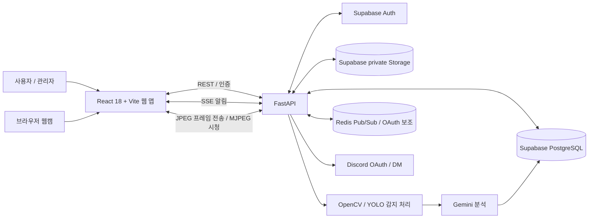
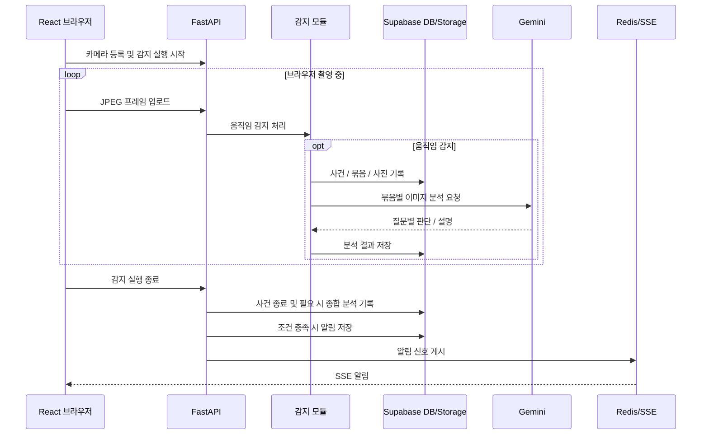

# 시스템 아키텍처 및 데이터 흐름

> NoteCam의 주요 구성요소와 감지·분석·알림 데이터 흐름을 설명합니다.

## 1. 시스템 구성도

## 2. 움직임 감지·AI 분석 흐름

## 3. 데이터 보존 위치

| 데이터 | 저장 위치 |
|---|---|
| 사용자 인증 정보 | Supabase Auth (`auth.users`) |
| 사용자 프로필·피드백 | PostgreSQL (`profiles`, `feedback`) |
| 감지 실행·사건·묶음·분석 | PostgreSQL (`motion_*`) |
| 감지 이미지 원본 | Supabase private Storage (`motion-evidence`, 코드 문서 기준) |
| 웹 알림·발송 결과 | PostgreSQL (`notifications`, `discord_deliveries`) |
| 알림 실시간 신호 | Redis Pub/Sub → FastAPI SSE |
| Discord 연결 상태 | PostgreSQL (`discord_connections`) |

## 4. 중요한 구현 특성

- 웹캠은 **브라우저**에서 열고 JPEG 프레임을 FastAPI로 전송합니다. 서버가 사용자의 카메라 장치를 직접 여는 구조로 단정하면 안 됩니다.
- 사진 묶음은 저장하지만 전체 원본 동영상을 영구 저장하는 방식은 아닙니다.
- 묶음 1개면 기존 분석을 재사용하고, 2개 이상이면 사건 종합 분석이 별도로 수행될 수 있습니다.
- 사용자 알림은 DB 조회와 Redis 기반 SSE를 구분합니다.
- 관리자 감사 로그와 AI 처리 로그는 서로 다른 개념입니다. 현재 캡처된 운영현황을 실시간 시스템 로그 대시보드라고 표기하지 않습니다.
