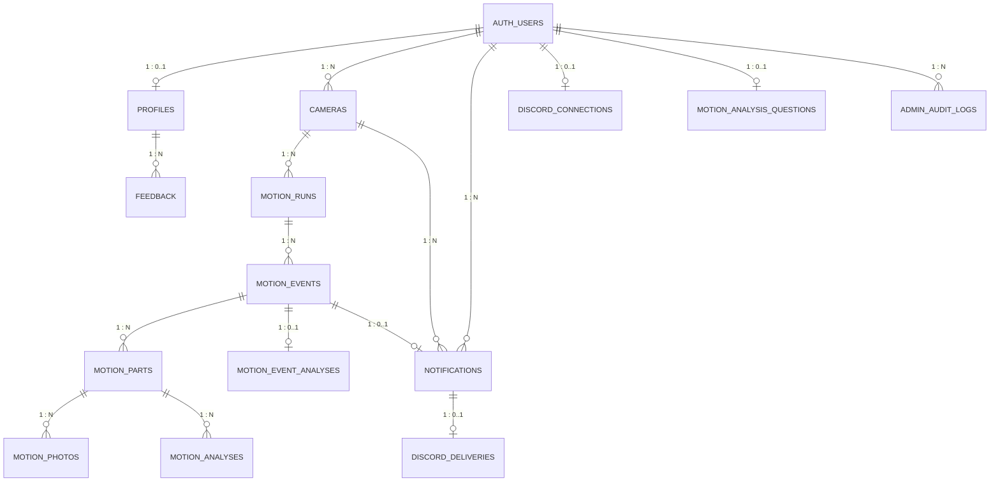

# 데이터베이스 설계서

> 기준: 사용자 제공 Supabase `information_schema.columns` 및 `pg_constraint` 조회 결과 (2026-10-22). **실제 DB 구조**를 우선하며 코드의 오래된 README보다 우선합니다.

## 1. 개요

- `public` 테이블 14개, 외부 참조 `auth.users` 1개 (Supabase Auth 관리 테이블)
- 실제 컬럼, PK, FK, UNIQUE, CHECK를 반영했습니다. 인덱스 전체·RLS 정책·Storage 버킷 실재 여부는 이번 조회로 검증하지 않았습니다.
- `bigint` ID의 시퀀스/IDENTITY 여부는 조회 결과의 `column_default=null`만으로 확정하지 않습니다.

## 2. 논리 ERD

> 관계선은 FK를 기반으로 하며 1:N/0..1은 구조적 의미를 간략히 나타냅니다. nullable FK나 복합 유니크 등 세부 조건은 아래 물리 명세를 우선합니다.

## 3. 물리 ERD

## 4. 테이블별 컬럼 명세

### `profiles`

| 컬럼 | PostgreSQL 타입 | 키 |
|---|---|---|
| `id` | `uuid` | PK, FK |
| `display_name` | `text` | - |
| `role` | `text` | - |
| `created_at` | `timestamptz` | - |
| `status` | `text` | - |
| `updated_at` | `timestamptz` | - |

**CHECK:** role ∈ {user, admin}; status ∈ {active, inactive}.

### `admin_audit_logs`

| 컬럼 | PostgreSQL 타입 | 키 |
|---|---|---|
| `id` | `bigint` | PK |
| `actor_id` | `uuid` | FK |
| `action` | `text` | - |
| `target_type` | `text` | - |
| `target_id` | `text` | - |
| `old_data` | `jsonb` | - |
| `new_data` | `jsonb` | - |
| `created_at` | `timestamptz` | - |

**CHECK:** target_type ∈ {users, feedback}.

### `cameras`

| 컬럼 | PostgreSQL 타입 | 키 |
|---|---|---|
| `id` | `uuid` | PK |
| `owner_id` | `uuid` | FK |
| `name` | `text` | - |
| `away_mode` | `boolean` | - |
| `last_seen_at` | `timestamptz` | - |
| `created_at` | `timestamptz` | - |

**CHECK:** 별도 CHECK 없음.

### `discord_connections`

| 컬럼 | PostgreSQL 타입 | 키 |
|---|---|---|
| `user_id` | `uuid` | PK, FK |
| `discord_user_id` | `text` | - |
| `display_name` | `text` | - |
| `dm_channel_id` | `text` | - |
| `dm_verified_at` | `timestamptz` | - |
| `notifications_enabled` | `boolean` | - |
| `enabled_at` | `timestamptz` | - |
| `last_error` | `text` | - |
| `updated_at` | `timestamptz` | - |

**CHECK:** Discord ID 형식 검증; display_name 1~100자; 알림 활성화 시 DM 인증 필요.

**UNIQUE:** `(discord_user_id)`.

### `discord_deliveries`

| 컬럼 | PostgreSQL 타입 | 키 |
|---|---|---|
| `notification_id` | `bigint` | PK, FK |
| `discord_user_id` | `text` | - |
| `status` | `text` | - |
| `attempts` | `integer` | - |
| `available_at` | `timestamptz` | - |
| `lease_until` | `timestamptz` | - |
| `claim_token` | `uuid` | - |
| `message_id` | `text` | - |
| `sent_at` | `timestamptz` | - |
| `last_error` | `text` | - |

**CHECK:** status ∈ {queued, sending, sent, failed, skipped}; attempts 0~5.

### `feedback`

| 컬럼 | PostgreSQL 타입 | 키 |
|---|---|---|
| `id` | `bigint` | PK |
| `user_id` | `uuid` | FK |
| `title` | `text` | - |
| `kind` | `text` | - |
| `content` | `text` | - |
| `status` | `text` | - |
| `created_at` | `timestamptz` | - |
| `admin_note` | `text` | - |
| `updated_at` | `timestamptz` | - |
| `deleted_at` | `timestamptz` | - |

**CHECK:** kind ∈ {false_positive, false_negative, accurate, suggestion}; status ∈ {pending, in_progress, resolved}.

### `motion_analyses`

| 컬럼 | PostgreSQL 타입 | 키 |
|---|---|---|
| `id` | `uuid` | PK |
| `part_id` | `uuid` | FK |
| `origin` | `text` | - |
| `model_name` | `text` | - |
| `status` | `text` | - |
| `result` | `jsonb` | - |
| `error_message` | `text` | - |
| `created_at` | `timestamptz` | - |
| `finished_at` | `timestamptz` | - |
| `latency_ms` | `integer` | - |
| `questions` | `jsonb` | - |

**CHECK:** origin ∈ {auto, manual}; status ∈ {queued, running, succeeded, failed}; latency_ms ≥ 0; questions JSON array 1~5개.

### `motion_analysis_questions`

| 컬럼 | PostgreSQL 타입 | 키 |
|---|---|---|
| `user_id` | `uuid` | PK, FK |
| `updated_at` | `timestamptz` | - |
| `questions` | `jsonb` | - |
| `notify_on_uncertain` | `boolean` | - |

**CHECK:** questions JSON array 1~5개.

### `motion_event_analyses`

| 컬럼 | PostgreSQL 타입 | 키 |
|---|---|---|
| `id` | `uuid` | PK |
| `event_id` | `text` | FK |
| `model_name` | `text` | - |
| `sources` | `jsonb` | - |
| `status` | `text` | - |
| `result` | `jsonb` | - |
| `error_message` | `text` | - |
| `created_at` | `timestamptz` | - |
| `finished_at` | `timestamptz` | - |
| `latency_ms` | `integer` | - |
| `questions` | `jsonb` | - |

**CHECK:** status ∈ {running, succeeded, failed}; latency_ms ≥ 0; questions JSON array 1~5개.

**UNIQUE:** `(event_id)`.

### `motion_events`

| 컬럼 | PostgreSQL 타입 | 키 |
|---|---|---|
| `id` | `text` | PK |
| `run_id` | `text` | FK |
| `detected_at` | `timestamptz` | - |
| `capture_state` | `text` | - |
| `final_part_index` | `integer` | - |
| `questions` | `jsonb` | - |

**CHECK:** capture_state ∈ {collecting, closed, interrupted}; final_part_index > 0; questions JSON array 1~5개.

### `motion_parts`

| 컬럼 | PostgreSQL 타입 | 키 |
|---|---|---|
| `id` | `uuid` | PK |
| `event_id` | `text` | FK |
| `part_index` | `integer` | - |
| `metadata` | `jsonb` | - |

**CHECK:** part_index > 0.

**UNIQUE:** `(event_id, part_index)`.

### `motion_photos`

| 컬럼 | PostgreSQL 타입 | 키 |
|---|---|---|
| `id` | `uuid` | PK |
| `part_id` | `uuid` | FK |
| `sequence_no` | `integer` | - |
| `storage_key` | `text` | - |
| `timestamp_sec` | `double precision` | - |
| `upload_status` | `text` | - |
| `byte_size` | `integer` | - |
| `sha256` | `text` | - |

**CHECK:** sequence_no > 0; timestamp_sec ≥ 0; byte_size 1~12,582,912; sha256 소문자 64자리; upload_status ∈ {pending, ready}.

**UNIQUE:** `(storage_key)`; `(part_id, sequence_no)`.

### `motion_runs`

| 컬럼 | PostgreSQL 타입 | 키 |
|---|---|---|
| `id` | `text` | PK |
| `camera_id` | `uuid` | FK |
| `config` | `jsonb` | - |
| `status` | `text` | - |
| `requested_at` | `timestamptz` | - |
| `started_at` | `timestamptz` | - |
| `finished_at` | `timestamptz` | - |
| `error_message` | `text` | - |

**CHECK:** status ∈ {starting, running, stopping, stopped, failed}.

### `notifications`

| 컬럼 | PostgreSQL 타입 | 키 |
|---|---|---|
| `id` | `bigint` | PK |
| `owner_id` | `uuid` | FK |
| `event_id` | `text` | FK |
| `camera_id` | `uuid` | FK |
| `kind` | `text` | - |
| `verdict` | `text` | - |
| `message` | `text` | - |
| `read` | `boolean` | - |
| `created_at` | `timestamptz` | - |

**CHECK:** kind = motion; verdict ∈ {confirmed, uncertain}; message 공백 제거 후 1~500자.

**UNIQUE:** `(event_id)`.

## 5. FK 목록

| 자식 테이블.컬럼 | 참조 대상 |
|---|---|
| `profiles.id` | `auth.users.id` |
| `feedback.user_id` | `profiles.id` |
| `cameras.owner_id` | `auth.users.id` |
| `motion_runs.camera_id` | `cameras.id` |
| `motion_events.run_id` | `motion_runs.id` |
| `motion_parts.event_id` | `motion_events.id` |
| `motion_photos.part_id` | `motion_parts.id` |
| `motion_analyses.part_id` | `motion_parts.id` |
| `motion_event_analyses.event_id` | `motion_events.id` |
| `motion_analysis_questions.user_id` | `auth.users.id` |
| `admin_audit_logs.actor_id` | `auth.users.id` |
| `notifications.owner_id` | `auth.users.id` |
| `notifications.camera_id` | `cameras.id` |
| `notifications.event_id` | `motion_events.id` |
| `discord_connections.user_id` | `auth.users.id` |
| `discord_deliveries.notification_id` | `notifications.id` |

## 6. 실제 DB 기준 주의 사항

- `notifications` 테이블은 실제 조회에서 **존재**함을 확인했습니다. 기존 백엔드 `docs/API_CONTRACT.md`의 “notifications 테이블 없음” 설명은 이전 상태로 보입니다.
- `feedback`은 사건 FK가 없는 독립 피드백입니다.
- `motion_event_analyses.event_id`, `notifications.event_id`는 UNIQUE로 사건별 최대 1행입니다.
- `discord_deliveries.notification_id`는 PK이자 FK입니다.
- `profiles.role`과 `profiles.status`는 관리자 권한 판정에 사용됩니다.
- `auth.users` 컬럼 전체는 Supabase 관리 영역이라 이 문서에 재현하지 않았습니다.
