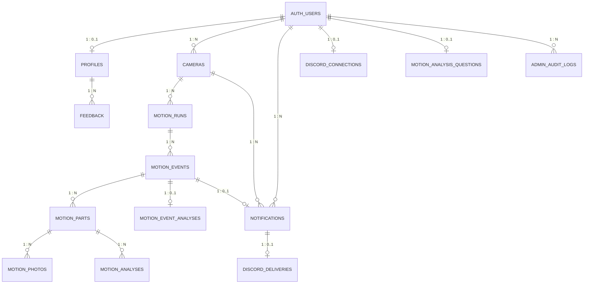
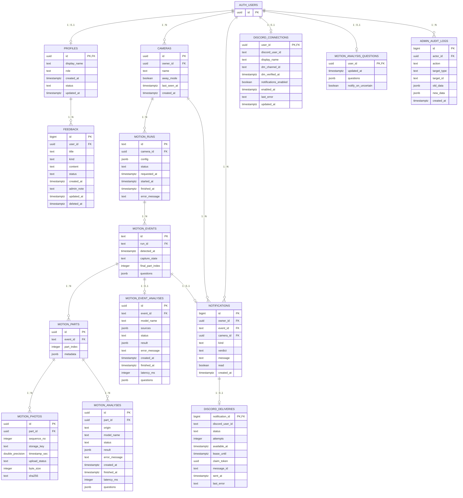

# 데이터베이스 설계서

> NoteCam의 Supabase PostgreSQL 데이터 모델을 기준으로 테이블, 관계, 키 및 제약조건을 정리합니다.

## 1. 개요

- `public` 테이블 14개, 외부 참조 `auth.users` 1개 (Supabase Auth 관리 테이블)
- `public` 테이블의 컬럼, PK, FK, UNIQUE 및 CHECK 제약조건을 중심으로 물리 데이터 모델을 기술합니다.
- `bigint` ID의 시퀀스/IDENTITY 여부는 조회 결과의 `column_default=null`만으로 확정하지 않습니다.

## 2. 논리 ERD

> 관계선은 FK를 기반으로 하며 1:N/0..1은 구조적 의미를 간략히 나타냅니다. nullable FK나 복합 유니크 등 세부 조건은 아래 물리 명세를 우선합니다.

## 3. 물리 ERD

## 4. 테이블별 컬럼 명세

### `profiles`

| 컬럼 | PostgreSQL 타입 | 키 |
|---|---|---|
| `id` | `uuid` | PK, FK |
| `display_name` | `text` | - |
| `role` | `text` | - |
| `created_at` | `timestamptz` | - |
| `status` | `text` | - |
| `updated_at` | `timestamptz` | - |

**CHECK:** role ∈ {user, admin}; status ∈ {active, inactive}.

### `admin_audit_logs`

| 컬럼 | PostgreSQL 타입 | 키 |
|---|---|---|
| `id` | `bigint` | PK |
| `actor_id` | `uuid` | FK |
| `action` | `text` | - |
| `target_type` | `text` | - |
| `target_id` | `text` | - |
| `old_data` | `jsonb` | - |
| `new_data` | `jsonb` | - |
| `created_at` | `timestamptz` | - |

**CHECK:** target_type ∈ {users, feedback}.

### `cameras`

| 컬럼 | PostgreSQL 타입 | 키 |
|---|---|---|
| `id` | `uuid` | PK |
| `owner_id` | `uuid` | FK |
| `name` | `text` | - |
| `away_mode` | `boolean` | - |
| `last_seen_at` | `timestamptz` | - |
| `created_at` | `timestamptz` | - |

**CHECK:** 별도 CHECK 없음.

### `discord_connections`

| 컬럼 | PostgreSQL 타입 | 키 |
|---|---|---|
| `user_id` | `uuid` | PK, FK |
| `discord_user_id` | `text` | - |
| `display_name` | `text` | - |
| `dm_channel_id` | `text` | - |
| `dm_verified_at` | `timestamptz` | - |
| `notifications_enabled` | `boolean` | - |
| `enabled_at` | `timestamptz` | - |
| `last_error` | `text` | - |
| `updated_at` | `timestamptz` | - |

**CHECK:** Discord ID 형식 검증; display_name 1~100자; 알림 활성화 시 DM 인증 필요.

**UNIQUE:** `(discord_user_id)`.

### `discord_deliveries`

| 컬럼 | PostgreSQL 타입 | 키 |
|---|---|---|
| `notification_id` | `bigint` | PK, FK |
| `discord_user_id` | `text` | - |
| `status` | `text` | - |
| `attempts` | `integer` | - |
| `available_at` | `timestamptz` | - |
| `lease_until` | `timestamptz` | - |
| `claim_token` | `uuid` | - |
| `message_id` | `text` | - |
| `sent_at` | `timestamptz` | - |
| `last_error` | `text` | - |

**CHECK:** status ∈ {queued, sending, sent, failed, skipped}; attempts 0~5.

### `feedback`

| 컬럼 | PostgreSQL 타입 | 키 |
|---|---|---|
| `id` | `bigint` | PK |
| `user_id` | `uuid` | FK |
| `title` | `text` | - |
| `kind` | `text` | - |
| `content` | `text` | - |
| `status` | `text` | - |
| `created_at` | `timestamptz` | - |
| `admin_note` | `text` | - |
| `updated_at` | `timestamptz` | - |
| `deleted_at` | `timestamptz` | - |

**CHECK:** kind ∈ {false_positive, false_negative, accurate, suggestion}; status ∈ {pending, in_progress, resolved}.

### `motion_analyses`

| 컬럼 | PostgreSQL 타입 | 키 |
|---|---|---|
| `id` | `uuid` | PK |
| `part_id` | `uuid` | FK |
| `origin` | `text` | - |
| `model_name` | `text` | - |
| `status` | `text` | - |
| `result` | `jsonb` | - |
| `error_message` | `text` | - |
| `created_at` | `timestamptz` | - |
| `finished_at` | `timestamptz` | - |
| `latency_ms` | `integer` | - |
| `questions` | `jsonb` | - |

**CHECK:** origin ∈ {auto, manual}; status ∈ {queued, running, succeeded, failed}; latency_ms ≥ 0; questions JSON array 1~5개.

### `motion_analysis_questions`

| 컬럼 | PostgreSQL 타입 | 키 |
|---|---|---|
| `user_id` | `uuid` | PK, FK |
| `updated_at` | `timestamptz` | - |
| `questions` | `jsonb` | - |
| `notify_on_uncertain` | `boolean` | - |

**CHECK:** questions JSON array 1~5개.

### `motion_event_analyses`

| 컬럼 | PostgreSQL 타입 | 키 |
|---|---|---|
| `id` | `uuid` | PK |
| `event_id` | `text` | FK |
| `model_name` | `text` | - |
| `sources` | `jsonb` | - |
| `status` | `text` | - |
| `result` | `jsonb` | - |
| `error_message` | `text` | - |
| `created_at` | `timestamptz` | - |
| `finished_at` | `timestamptz` | - |
| `latency_ms` | `integer` | - |
| `questions` | `jsonb` | - |

**CHECK:** status ∈ {running, succeeded, failed}; latency_ms ≥ 0; questions JSON array 1~5개.

**UNIQUE:** `(event_id)`.

### `motion_events`

| 컬럼 | PostgreSQL 타입 | 키 |
|---|---|---|
| `id` | `text` | PK |
| `run_id` | `text` | FK |
| `detected_at` | `timestamptz` | - |
| `capture_state` | `text` | - |
| `final_part_index` | `integer` | - |
| `questions` | `jsonb` | - |

**CHECK:** capture_state ∈ {collecting, closed, interrupted}; final_part_index > 0; questions JSON array 1~5개.

### `motion_parts`

| 컬럼 | PostgreSQL 타입 | 키 |
|---|---|---|
| `id` | `uuid` | PK |
| `event_id` | `text` | FK |
| `part_index` | `integer` | - |
| `metadata` | `jsonb` | - |

**CHECK:** part_index > 0.

**UNIQUE:** `(event_id, part_index)`.

### `motion_photos`

| 컬럼 | PostgreSQL 타입 | 키 |
|---|---|---|
| `id` | `uuid` | PK |
| `part_id` | `uuid` | FK |
| `sequence_no` | `integer` | - |
| `storage_key` | `text` | - |
| `timestamp_sec` | `double precision` | - |
| `upload_status` | `text` | - |
| `byte_size` | `integer` | - |
| `sha256` | `text` | - |

**CHECK:** sequence_no > 0; timestamp_sec ≥ 0; byte_size 1~12,582,912; sha256 소문자 64자리; upload_status ∈ {pending, ready}.

**UNIQUE:** `(storage_key)`; `(part_id, sequence_no)`.

### `motion_runs`

| 컬럼 | PostgreSQL 타입 | 키 |
|---|---|---|
| `id` | `text` | PK |
| `camera_id` | `uuid` | FK |
| `config` | `jsonb` | - |
| `status` | `text` | - |
| `requested_at` | `timestamptz` | - |
| `started_at` | `timestamptz` | - |
| `finished_at` | `timestamptz` | - |
| `error_message` | `text` | - |

**CHECK:** status ∈ {starting, running, stopping, stopped, failed}.

### `notifications`

| 컬럼 | PostgreSQL 타입 | 키 |
|---|---|---|
| `id` | `bigint` | PK |
| `owner_id` | `uuid` | FK |
| `event_id` | `text` | FK |
| `camera_id` | `uuid` | FK |
| `kind` | `text` | - |
| `verdict` | `text` | - |
| `message` | `text` | - |
| `read` | `boolean` | - |
| `created_at` | `timestamptz` | - |

**CHECK:** kind = motion; verdict ∈ {confirmed, uncertain}; message 공백 제거 후 1~500자.

**UNIQUE:** `(event_id)`.

## 5. FK 목록

| 자식 테이블.컬럼 | 참조 대상 |
|---|---|
| `profiles.id` | `auth.users.id` |
| `feedback.user_id` | `profiles.id` |
| `cameras.owner_id` | `auth.users.id` |
| `motion_runs.camera_id` | `cameras.id` |
| `motion_events.run_id` | `motion_runs.id` |
| `motion_parts.event_id` | `motion_events.id` |
| `motion_photos.part_id` | `motion_parts.id` |
| `motion_analyses.part_id` | `motion_parts.id` |
| `motion_event_analyses.event_id` | `motion_events.id` |
| `motion_analysis_questions.user_id` | `auth.users.id` |
| `admin_audit_logs.actor_id` | `auth.users.id` |
| `notifications.owner_id` | `auth.users.id` |
| `notifications.camera_id` | `cameras.id` |
| `notifications.event_id` | `motion_events.id` |
| `discord_connections.user_id` | `auth.users.id` |
| `discord_deliveries.notification_id` | `notifications.id` |

## 6. 데이터 모델 설계 원칙

- `notifications`는 사건별 웹 알림 및 읽음 상태를 관리합니다.
- `feedback`은 사건 FK가 없는 독립 피드백입니다.
- `motion_event_analyses.event_id`, `notifications.event_id`는 UNIQUE로 사건별 최대 1행입니다.
- `discord_deliveries.notification_id`는 PK이자 FK입니다.
- `profiles.role`과 `profiles.status`는 관리자 권한 판정에 사용됩니다.
- `auth.users`는 Supabase Auth에서 관리하며, 서비스 테이블은 사용자 식별자를 참조합니다.

## 7. 데이터 무결성·보안·저장소 설계

### 7.1 PK/FK 및 삭제 정책

- `auth.users`는 Supabase Auth 관리 영역이며 이 문서의 `public` 14개 테이블 수에 포함되지 않습니다.
- `profiles.id`, `discord_connections.user_id`, `motion_analysis_questions.user_id`는 각각 `auth.users.id`를 참조하는 공유 식별자입니다.
- `feedback.user_id → profiles.id`는 사용자 삭제 시 CASCADE, `admin_audit_logs.actor_id → auth.users.id`는 삭제 시 SET NULL입니다.
- `discord_connections.user_id → auth.users.id`, `discord_deliveries.notification_id → notifications.id`, `notifications.owner_id → auth.users.id`, `notifications.event_id → motion_events.id`는 CASCADE입니다.
- FK의 삭제 동작은 각 관계에 정의된 참조 무결성 정책을 따릅니다.

### 7.2 중요 제약조건 및 업무 규칙

| 테이블 | 무결성 규칙 | 의미 |
|---|---|---|
| `profiles` | `role` user/admin, `status` active/inactive | 서버의 권한 및 접근 차단 기준 |
| `feedback` | `kind` 4종, `status` 3종, `deleted_at` | 분류·처리 상태·논리 삭제 |
| `motion_runs` | `status` starting/running/stopping/stopped/failed | 감지 실행 생명주기 |
| `motion_events` | `capture_state` collecting/closed/interrupted, `final_part_index` 양수 | 사건 종료 및 묶음 수 확인 |
| `motion_parts` | UNIQUE (`event_id`, `part_index`) | 같은 사건 내 묶음 순번 중복 방지 |
| `motion_photos` | UNIQUE (`storage_key`), (`part_id`, `sequence_no`) | 파일 키·묶음 내 사진 순서 중복 방지 |
| `motion_photos` | `byte_size` 1~12,582,912, `sha256` 64자리 소문자 hex | 사진 크기·무결성 형식 제한 |
| `motion_analyses` | `origin` auto/manual, `status` 4종, `latency_ms` ≥ 0 | 자동/수동 분석 및 처리 지연 |
| `motion_event_analyses` | UNIQUE (`event_id`) | 사건 종합 분석 최대 1행 |
| `notifications` | UNIQUE (`event_id`), `verdict` confirmed/uncertain | 사건당 알림 최대 1행 |
| `discord_deliveries` | `notification_id` PK/FK, `attempts` 0~5 | 알림당 발송 작업 최대 1행 |

### 7.3 접근 제어 및 데이터 보호

- 사용자 인증은 Supabase Auth JWT를 사용하며, 서버에서 `profiles.role`과 `profiles.status`를 확인합니다.
- 카메라, 사건 및 피드백은 소유 사용자 기준으로 접근 범위를 구분합니다.
- 관리자 기능은 `admin` 역할을 가진 활성 계정에 한해 제공됩니다.
- 촬영 이미지는 비공개 저장소와 인증된 API를 통해 관리합니다.
- Service Role 키와 외부 서비스 비밀 키는 서버 측에서만 사용합니다.

### 7.5 테이블별 사용 흐름

`auth.users → profiles → feedback → admin_audit_logs`는 계정·고객 문의·관리 이력 영역입니다. `cameras → motion_runs → motion_events → motion_parts → motion_photos`는 촬영 증거 계층이며, `motion_analyses`는 사진 묶음별 AI 결과, `motion_event_analyses`는 사건 단위 종합 결과입니다. `motion_analysis_questions`는 사용자별 질문 설정을 보존합니다. `notifications → discord_deliveries`와 `discord_connections`는 웹·외부 알림 전송 상태를 분리해 기록합니다.
