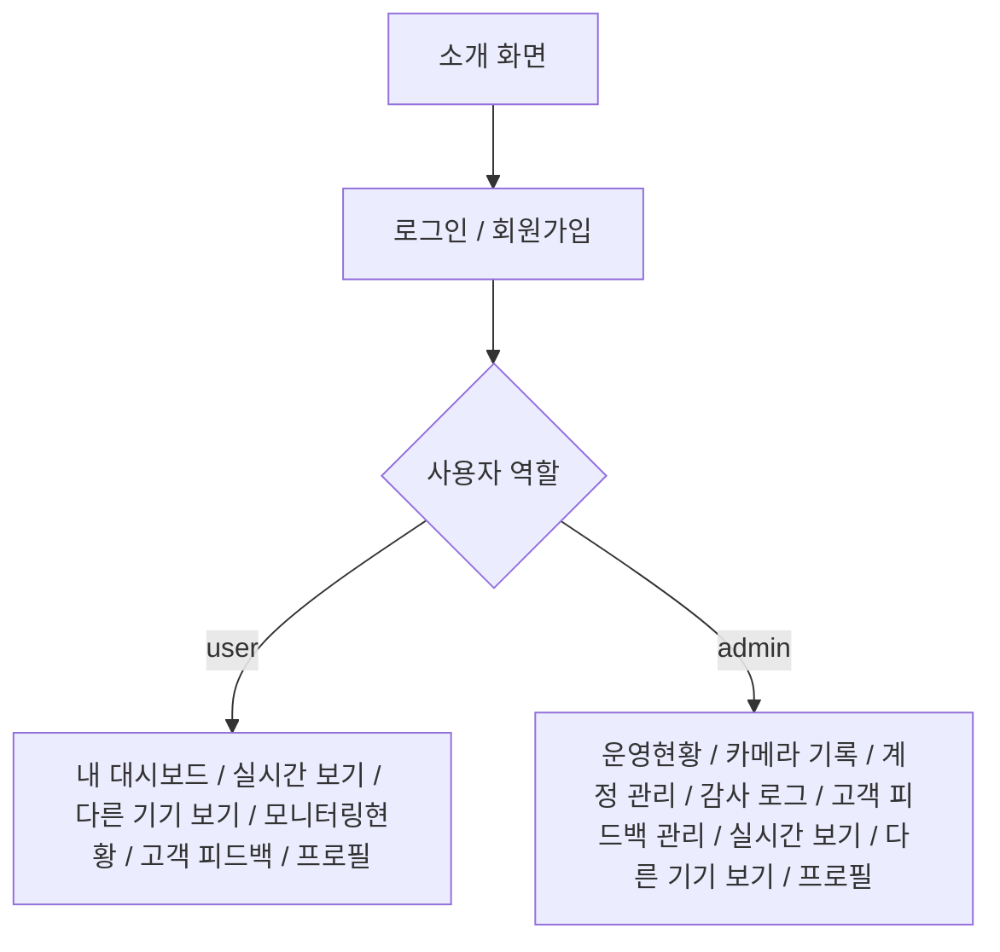

# 화면 설계서 (IA 및 실제 화면)

> 기준: 사용자 제공 1920×1080 캡처 18장과 프론트엔드 `main`의 `navigation.js` / README.

## 1. 화면 정보 구조

> `다른 기기 보기`, `나의 프로필`, `감사 로그`는 프론트 메뉴 코드에서 확인되지만 제공된 18장 캡처에 별도 이미지가 없습니다.

## 2. 캡처별 화면 명세

| 이미지 | 화면 | 대상 | 기능 |
|---|---|---|---|
| [01-landing.jpg](../screenshots/01-landing.jpg) | 소개 화면 | 공통 | 서비스 소개 및 로그인 이동 |
| [02-login.jpg](../screenshots/02-login.jpg) | 로그인 | 공통 | 이메일·비밀번호 로그인 |
| [03-register.jpg](../screenshots/03-register.jpg) | 회원가입 | 공통 | 신규 계정 등록 |
| [04-user-dashboard.jpg](../screenshots/04-user-dashboard.jpg) | 내 대시보드 | 사용자 | 카메라·이벤트·알림 요약 |
| [05-live-camera.jpg](../screenshots/05-live-camera.jpg) | 실시간 보기 | 공통 | 카메라 입력 및 감지 제어 |
| [06-monitoring.jpg](../screenshots/06-monitoring.jpg) | 모니터링현황 | 사용자 | 사건·분석 기록 목록 |
| [07-event-detail.jpg](../screenshots/07-event-detail.jpg) | 사건 상세 | 사용자 | 감지 사진·AI 분석 |
| [08-notifications.jpg](../screenshots/08-notifications.jpg) | 알림 팝업 | 공통 | 알림 조회 및 읽음 |
| [09-feedback-list.jpg](../screenshots/09-feedback-list.jpg) | 고객 피드백 | 사용자 | 피드백 목록·검색 |
| [10-feedback-create.jpg](../screenshots/10-feedback-create.jpg) | 피드백 작성 | 사용자 | 제목·분류·내용 입력 |
| [11-admin-overview.jpg](../screenshots/11-admin-overview.jpg) | 운영현황 | 관리자 | 계정·피드백 통계 및 기록 |
| [12-admin-accounts.jpg](../screenshots/12-admin-accounts.jpg) | 계정 관리 | 관리자 | 계정 역할·활성 상태 |
| [13-admin-cameras.jpg](../screenshots/13-admin-cameras.jpg) | 카메라 기록 | 관리자 | 카메라 목록 |
| [14-admin-camera-events.jpg](../screenshots/14-admin-camera-events.jpg) | 카메라 사건 목록 | 관리자 | 카메라별 사건 기록 |
| [15-admin-event-detail.jpg](../screenshots/15-admin-event-detail.jpg) | 관리자 사건 상세 | 관리자 | 사건 사진 |
| [16-admin-gemini-analysis.jpg](../screenshots/16-admin-gemini-analysis.jpg) | Gemini 분석 결과 | 관리자 | 분석 결과·사진 |
| [17-admin-feedback.jpg](../screenshots/17-admin-feedback.jpg) | 고객 피드백 관리 | 관리자 | 전체 피드백 처리 |
| [18-admin-feedback-process.jpg](../screenshots/18-admin-feedback-process.jpg) | 피드백 처리 팝업 | 관리자 | 처리 상태·답변 수정 |

## 3. 대표 화면 미리보기

### 메인 화면

### 사용자 대시보드

### 사건 상세 / AI 분석

### 관리자 운영현황

### 관리자 Gemini 분석 기록

## 4. 화면·API 대응

| 화면 | 주 API |
|---|---|
| 로그인·회원가입 | `/api/auth/*` |
| 프로필 | `/api/users/me`, `/api/discord/*` |
| 실시간 보기 | `/api/motion/cameras`, `/api/motion/runs`, `/api/motion/questions` |
| 다른 기기 보기 | `/api/motion/runs`, `/api/motion/runs/{run_id}/preview-ticket` |
| 모니터링현황 | `/api/motion/events`, `/api/motion/events/{event_id}` |
| 알림 | `/api/notifications`, `/api/notifications/stream` |
| 고객 피드백 | `/api/feedback` |
| 관리자 운영현황·계정 | `/api/admin/users`, `/api/admin/feedback`, `/api/admin/audit-logs` |
| 관리자 카메라 기록 | `/api/admin/cameras`, `/api/admin/events/*`, `/api/admin/parts/*` |

## 5. 스크린샷 공개 전 검수

- 계정 이메일·사용자 ID·실제 인물 얼굴·개인 생활 공간이 보이면 공개 전 가리거나 해당 사진을 제외합니다.
- ZIP에는 원본 캡처를 그대로 정리했습니다. 자동 익명화하지 않았으므로 공개 GitHub 업로드 전 반드시 확인하세요.
- 운영현황 캡처는 서비스 관리 통계 화면이며, 별도 실시간 서버 로그 대시보드 증빙이라고 주장하지 않습니다.
