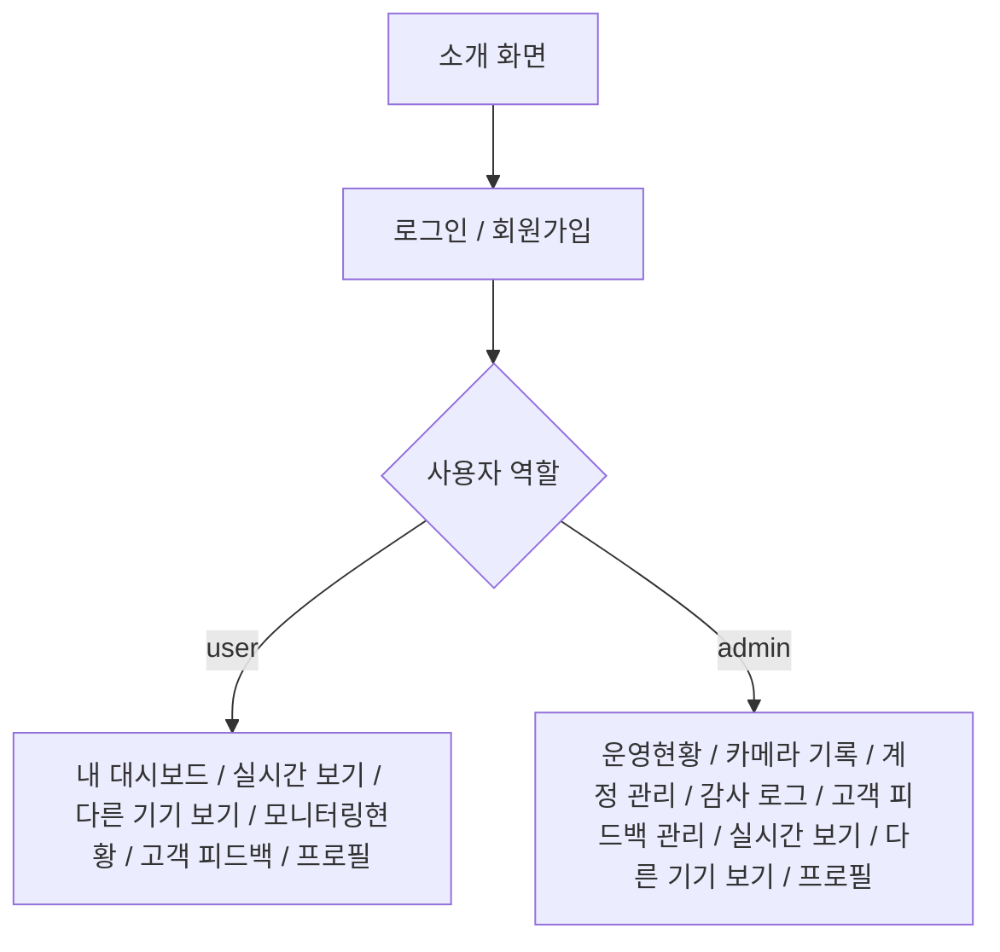

# 화면 설계서

> 사용자·관리자 화면의 정보 구조, 주요 기능, 입력 규칙 및 연계 API를 정리합니다.

## 1. 화면 정보 구조

## 2. 캡처별 화면 명세

| 이미지 | 화면 | 대상 | 기능 |
|---|---|---|---|
| [01-landing.jpg](../screenshots/01-landing.jpg) | 소개 화면 | 공통 | 서비스 소개 및 로그인 이동 |
| [02-login.jpg](../screenshots/02-login.jpg) | 로그인 | 공통 | 이메일·비밀번호 로그인 |
| [03-register.jpg](../screenshots/03-register.jpg) | 회원가입 | 공통 | 신규 계정 등록 |
| [04-user-dashboard.jpg](../screenshots/04-user-dashboard.jpg) | 내 대시보드 | 사용자 | 카메라·이벤트·알림 요약 |
| [05-live-camera.jpg](../screenshots/05-live-camera.jpg) | 실시간 보기 | 공통 | 카메라 입력 및 감지 제어 |
| [06-monitoring.jpg](../screenshots/06-monitoring.jpg) | 모니터링현황 | 사용자 | 사건·분석 기록 목록 |
| [07-event-detail.jpg](../screenshots/07-event-detail.jpg) | 사건 상세 | 사용자 | 감지 사진·AI 분석 |
| [08-notifications.jpg](../screenshots/08-notifications.jpg) | 알림 팝업 | 공통 | 알림 조회 및 읽음 |
| [09-feedback-list.jpg](../screenshots/09-feedback-list.jpg) | 고객 피드백 | 사용자 | 피드백 목록·검색 |
| [10-feedback-create.jpg](../screenshots/10-feedback-create.jpg) | 피드백 작성 | 사용자 | 제목·분류·내용 입력 |
| [11-admin-overview.jpg](../screenshots/11-admin-overview.jpg) | 운영현황 | 관리자 | 계정·피드백 통계 및 기록 |
| [12-admin-accounts.jpg](../screenshots/12-admin-accounts.jpg) | 계정 관리 | 관리자 | 계정 역할·활성 상태 |
| [13-admin-cameras.jpg](../screenshots/13-admin-cameras.jpg) | 카메라 기록 | 관리자 | 카메라 목록 |
| [14-admin-camera-events.jpg](../screenshots/14-admin-camera-events.jpg) | 카메라 사건 목록 | 관리자 | 카메라별 사건 기록 |
| [15-admin-event-detail.jpg](../screenshots/15-admin-event-detail.jpg) | 관리자 사건 상세 | 관리자 | 사건 사진 |
| [16-admin-gemini-analysis.jpg](../screenshots/16-admin-gemini-analysis.jpg) | Gemini 분석 결과 | 관리자 | 분석 결과·사진 |
| [17-admin-feedback.jpg](../screenshots/17-admin-feedback.jpg) | 고객 피드백 관리 | 관리자 | 전체 피드백 처리 |
| [18-admin-feedback-process.jpg](../screenshots/18-admin-feedback-process.jpg) | 피드백 처리 팝업 | 관리자 | 처리 상태·답변 수정 |

## 3. 대표 화면 미리보기

### 메인 화면

### 사용자 대시보드

### 사건 상세 / AI 분석

### 관리자 운영현황

### 관리자 Gemini 분석 기록

## 4. 화면·API 대응

| 화면 | 주 API |
|---|---|
| 로그인·회원가입 | `/api/auth/*` |
| 프로필 | `/api/users/me`, `/api/discord/*` |
| 실시간 보기 | `/api/motion/cameras`, `/api/motion/runs`, `/api/motion/questions` |
| 다른 기기 보기 | `/api/motion/runs`, `/api/motion/runs/{run_id}/preview-ticket` |
| 모니터링현황 | `/api/motion/events`, `/api/motion/events/{event_id}` |
| 알림 | `/api/notifications`, `/api/notifications/stream` |
| 고객 피드백 | `/api/feedback` |
| 관리자 운영현황·계정 | `/api/admin/users`, `/api/admin/feedback`, `/api/admin/audit-logs` |
| 관리자 카메라 기록 | `/api/admin/cameras`, `/api/admin/events/*`, `/api/admin/parts/*` |

## 6. 화면 상세 동작 명세

다음 표는 화면별 주요 조작, 연결 API 및 상태 처리 기준을 정리한 것입니다.

| 화면 | 사용자 입력·조작 | 연결 API / 데이터 | 예외·상태 처리 |
|---|---|---|---|
| 소개 | 로그인/회원가입 이동 | 프론트 라우팅 | 미로그인 상태에서 보호 화면 접근 제한 |
| 로그인 | 이메일, 비밀번호, 로그인 | `POST /api/auth/login`, `GET /api/auth/me` | 잘못된 자격증명·인증 실패 안내 |
| 회원가입 | 이메일, 비밀번호, 가입 | `POST /api/auth/register` | 이메일 형식, 비밀번호 10~128자, 이메일 인증 필요 여부 표시 |
| 사용자 대시보드 | 카메라/최근 사건·알림 확인 | `/api/motion/runs`, `/api/motion/events`, `/api/notifications` | 데이터 없음, 로딩, 통신 오류 구분 |
| 실시간 보기 | 카메라 권한 허용, 등록·선택, 감지 시작/중지 | `/api/motion/cameras`, `/api/motion/runs`, `/frames`, `/stop` | 카메라 권한 거부, 실행 충돌, 전송 실패 처리 |
| 다른 기기 보기 | 활성 실행 선택, 미리보기 연결/해제 | `/api/motion/runs?active_only=true`, `/preview-ticket` | 실행 서버 불일치·티켓 만료·연결 실패 처리 |
| 모니터링현황 | 사건 목록·상세 이동 | `/api/motion/events` | 빈 목록, 분석 대기/실패 구분 |
| 사건 상세 | 사진 묶음, AI 분석 확인 | `/events/{id}`, `/parts`, `/analysis` | 사진 미업로드, 분석 진행·실패·판단 어려움 구분 |
| 알림 | 목록, 읽음 처리 | `/api/notifications`, `/{id}/read`, `/stream` | SSE 미연결 시 DB 조회 목록 조회 지원 |
| 피드백 목록 | 검색, 상태/종류 필터, 상세 이동 | `GET /api/feedback` | 검색 결과 없음, 본인 데이터만 표시 |
| 피드백 작성 | 제목, 유형, 본문, 등록 | `POST /api/feedback` | 제목 1~100자, 본문 1~1000자, 종류 4종 |
| 관리자 운영현황 | 회원·피드백 통계 조회 | 관리자 사용자·피드백 API | 서버 운영 로그 대시보드와는 별개 |
| 관리자 계정 관리 | 사용자 선택, 역할·상태 변경 | `GET/PATCH /api/admin/users` | 관리자 권한 없음 403, 마지막 관리자 제거 409 |
| 관리자 카메라 기록 | 카메라·사건 선택 | `/api/admin/cameras`, `/events` | 비전 비활성 시 503 |
| 관리자 사건 상세 | 사진·분석 이력 조회 | `/api/admin/events`, `/parts`, `/analyses` | 비공개 사진 인증, 사진 대기 409 |
| 관리자 피드백 관리 | 상태 변경, 답변 메모, 삭제 | `GET/PATCH/DELETE /api/admin/feedback` | 상태 3종, 답변 1000자 이내, 삭제 204 |
| 관리자 감사 로그 | 관리자 변경 이력 조회 | `GET /api/admin/audit-logs` | 서버 에러 로그가 아닌 계정/피드백 관리 감사 기록 |
| 프로필/Discord | 표시 이름 수정, Discord 연결/알림 설정 | `/api/users/me`, `/api/discord/*` | 연결 기능 비활성 시 503, 권한/인증 오류 |

### 6.1 주요 입력 검증 기준

- 회원가입 비밀번호: 10~128자. 로그인 비밀번호 입력 모델은 1~128자.
- 표시 이름: 1~40자. 카메라 이름: trim 후 1~80자.
- 피드백 제목: 1~100자, 내용: 1~1000자, 유형: `false_positive`, `false_negative`, `accurate`, `suggestion`.
- 사용자 피드백 수정: 변경할 필드 최소 1개, `null` 불가. 관리자 피드백 상태: `pending`, `in_progress`, `resolved`.
- 분석 질문: 1~5개, 질문당 최대 4000자, 전체 4000자, 중복 질문 금지.

### 6.2 화면 상태 처리

| 상태 | 처리 기준 |
|---|---|
| 카메라 접근 거부 | 브라우저 카메라 권한 안내 |
| AI 분석 대기 | `queued`·`running` 상태 구분 |
| AI 분석 실패 | `failed` 상태 및 오류 정보 표시 |
| AI 판단 불확실 | `uncertain` 결과와 분석 요약 표시 |
| 알림 연결 중단 | 알림 목록 조회와 실시간 SSE 연결 상태 구분 |
| 검색 결과 없음 | 빈 목록 상태 표시 |
| 접근 권한 없음 | 관리자·사용자 권한에 따른 접근 제한 |
